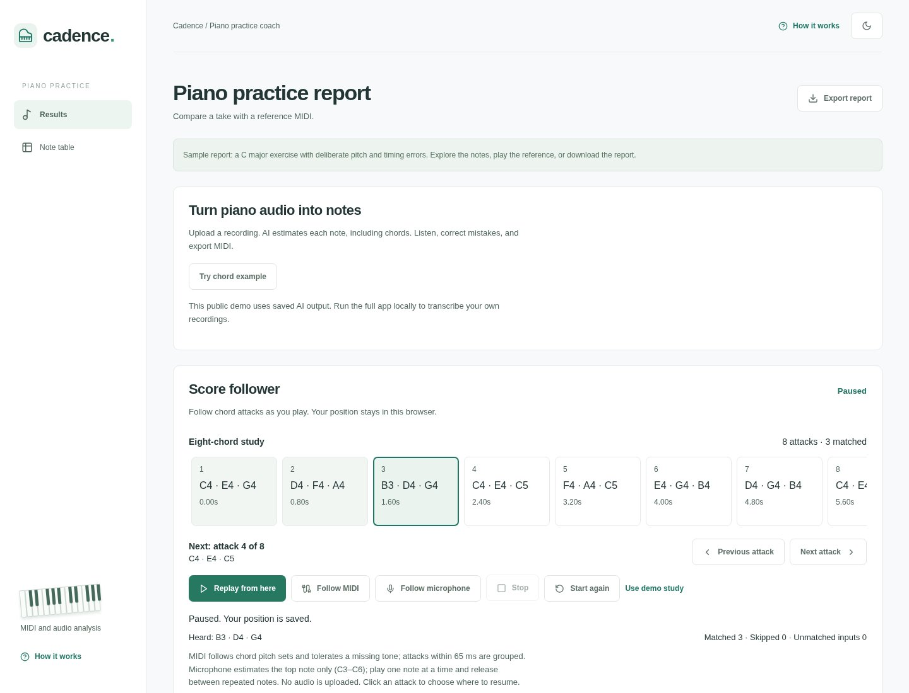
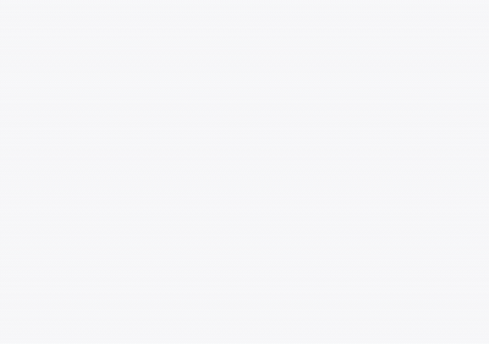

# Cadence

[Open the live sample report](https://cadence-piano.cadence-deployment.workers.dev)

I built Cadence to compare a piano take with a MIDI reference and find the bars I should practice again. I use React for the report, FastAPI for uploads, pretty_midi for MIDI, and librosa for audio. The app checks pitch and timing. It does not grade musical expression.



[Architecture and scoring decisions](docs/architecture.md) · [Demo walkthrough](docs/walkthrough.md) · [Checks and limits](docs/review.md)

### Watch the score follower

The silent recording shows replay, pause, a page reload, and recovery to the next
attack. The public demo keeps MIDI and microphone following in the browser;
reference uploads and full performance analysis require the local app.



[Download the MP4](docs/score-follower-demo.mp4) ·
[Desktop light](docs/laptop-light.png) · [Desktop dark](docs/laptop-dark.png) ·
[Mobile light](docs/phone-light.png) · [Mobile dark](docs/phone-dark.png)


## Quick demo, without installs

The repo includes a built demo in `demo/`. I keep it in the repo so the demo does not depend on downloading packages. From the project folder, run:

```sh
python demo_server.py
```

Open **http://127.0.0.1:5173**. Python 3 is the only requirement for this preview. Click **Quick demo**, **Play reference**, a note in the timeline, or a bar in the heatmap. **Export report** downloads the report as JSON. **Clear results** shows the empty state. The moon/sun button changes the theme.

The demo report is saved output from `backend/analysis.py`, with rule suggestions from `backend/recommendations.py`. The frontend does not make up scores. A test compares the saved JSON with a fresh Python result. The demo server serves that saved report; it does not analyze uploads. Stop it with Ctrl+C before starting the development frontend on the same port.

## Host the demo

The saved report can run on Cloudflare Workers as a free static site. The public build clearly labels sample data and links to the local app for real uploads. See [Cloudflare deployment](docs/cloudflare.md).

## Run real analysis

I tested the app on Windows with Node 24, Python 3.12, and a fresh Python 3.14 virtual environment. Use Node 20.19+ or 22.12+. Python 3.12 and 3.14 both passed my tests with the current dependencies.

From the project folder:

```sh
python -m venv .venv
```

Activate it on Windows PowerShell:

```powershell
.venv\Scripts\Activate.ps1
```

Then install and start the backend:

```sh
python -m pip install -r backend/requirements.txt
python -m uvicorn main:app --app-dir backend --host 127.0.0.1 --port 8000
```

In a second terminal:

```sh
cd frontend
npm ci
npm run dev
```

Open **http://127.0.0.1:5173**. The frontend forwards `/api` requests to Python on port 8000. API docs are at **http://127.0.0.1:8000/docs**. The first audio analysis can take longer because numerical functions compile. The saved demo starts quickly even without those packages.

## Input modes

**MIDI files:** choose `samples/reference.mid` and `samples/performance.mid`, then click Analyze performance. For my own music, I use two files covering the same passage. MIDI gives exact recorded pitch and note-on times. Chords are supported, but dense simultaneous notes can still make alignment ambiguous.

**Audio files:** choose the reference MIDI and `samples/performance.wav`. WAV, FLAC, and OGG are accepted. Audio results are estimates and work best on single-note passages in a quiet room. The tracker returns one pitch per attack. Chords, reverb, and pedal can confuse it. If the spectral check suggests overlapping sounds, scores and error counts are hidden by default. Show scores anyway reveals estimates labeled may be unreliable. `samples/chords.wav` is a short test of that warning.

**Microphone:** select Audio and click Record microphone. Allow the browser permission, play the passage, then stop. The browser saves mono PCM WAV before uploading it. Recording stops after 119 seconds. A pending permission request times out with a message. I tested the recording code with a generated audio stream, not a physical piano recording.

**Keyboard:** connect a USB MIDI keyboard and choose Keyboard. Use the optional reference MIDI field for another piece; leave it empty for the C major demo. Click Connect MIDI keyboard, record, then Stop & analyze. Note-off messages close each note. Still-held notes close when I stop. Chrome or Edge on localhost/HTTPS is needed. I tested live USB input with an Akai MPK mini 3 in Chrome, along with synthetic MIDI messages. Other devices and browsers still need testing.

I limit each file to 20 MB, the whole request to 22 MB, each sequence to 600 notes, and passages to two minutes. MP3, WebM uploads, and sheet-music OCR are outside this version.

## How I score a take

I align note sequences with a dynamic program related to DTW. A step can match two notes, skip a missed reference note, or mark an extra played note. I use one-to-one matches so a missed note cannot be hidden by mapping several events to the same note.

Before scoring, I remove the recording's constant start delay and fit its overall tempo from matched notes. With enough matches, I also fit gradual acceleration when a smooth curve explains the drift better. A consistently slower take can score 100. An isolated late entrance still counts as a timing error. This fit is a heuristic; repeated passages and very uneven tempo can confuse it.

The report counts **wrong pitches**, **missed notes**, and **extra notes** separately. It also counts early and late matches. A wrong pitch can also have a timing error.

- For MIDI, every note has weight 1. For audio, a matched or extra note's weight is the tracker's median voiced probability near its onset, between 0 and 1. This is an uncertainty estimate, not a proven probability that its pitch is right. Missed reference notes have weight 1 because there is no detected note to measure.
- **Pitch score:** 100 times the weight of correct-pitch matches, divided by matched weight plus missed-note count plus extra-note weight. Wrong pitches add to the denominator but not the numerator.
- **Timing score:** each matched note gets `exp(-abs(offset_ms) / 150)`, weighted by confidence. I divide the sum by matched weight plus missed-note count, then multiply by 100. Missing notes contribute zero. Extra notes affect pitch score, not timing score.
- **Overall score:** 55% pitch score and 45% timing score. These weights are choices I made for practice feedback, not a validated proficiency scale.

Offsets beyond 80 ms are labeled early or late. Audio notes below 50% confidence are labeled uncertain and have less influence. Suspected polyphonic audio withholds scores and counts until I click Show scores anyway. The estimates keep an unreliable label.

Bar boundaries come from the reference MIDI's tempo map and time signature. If the file omits a time signature, I assume 4/4 and show a warning. A pickup may be numbered differently from the printed score.

## Octaves and audio filtering

Before alignment, I try take offsets of -24, -12, 0, +12, and +24 semitones. I use the offset with the lowest cost from the existing alignment function; ties prefer no shift or the smaller shift. The report says when an octave adjustment was used. The table shows original pitches alongside the pitches used for comparison. This handles a keyboard set to another octave. It can also treat a passage intentionally played in another octave as an octave mismatch.

Audio detections of the same pitch within 150 ms are merged. Other detections need at least 60 ms duration, attack RMS at least 3% of the recording's peak RMS, and a 15% rise over the preceding 80 ms. The rise check removes false attacks during decay. These are general heuristics, checked on decaying synthetic tones at different pitches and volumes, separate repeated attacks, and the two real recordings.

Overlap checks use confident pitch frames 40 to 180 ms after an accepted attack. They allow small deviations from exact harmonics and require strong conflicting peaks in at least half the checked frames. This avoids treating all piano sustain as a chord. It can still miss overlap or flag resonance.

Extra notes go to the nearest time span occupied by reference notes in a bar, including their durations. This also handles silence around a bar boundary. The displayed extra time is still the aligned time.

## Real recording check

| File | Detected before / after | Extras before / after | Scores before / after |
| --- | --- | --- | --- |
| `samples/real/good.wav` | 40 / 32 | 8 / 0 | Hidden / shown |
| `samples/real/messed-up.wav` | 37 / 32 | 6 / 1 | Hidden / shown |

The phone recordings stay local and are not included in this repository. Their tests skip when the files are absent.

The clean take has 0 missed notes and 0 wrong pitches after filtering, with an estimated score of 91. The mistaken take has 1 missed note and 0 wrong pitches, with an estimated score of 71. Its remaining extra is still an estimate. I kept the alignment and tempo-fit functions unchanged for these fixes.

## Practice feedback

Exercises come from the errors measured in each bar. Wrong pitches lead to pitch checks, missed notes to short transition loops, and uneven entrances to metronome work. The same report produces the same exercises. Analysis and feedback run on the Python server; no external service or key is needed.

## Tests and build

From the project folder, with the virtual environment active:

```sh
python -m pytest backend -q
python backend/generate_samples.py
```

From `frontend/`:

```sh
npm test
npm run build
npm run preview
```

For the browser capture check, use the development frontend and open **http://127.0.0.1:5173/tests/capture.html**. Click Run capture checks. It records generated sound through the real AudioWorklet, decodes the resulting WAV, and runs synthetic MIDI input through the same capture function used by the app. It does not request a microphone or ship in the production build.

To rebuild the saved demo after editing the frontend or analysis:

```sh
python backend/generate_samples.py
cd frontend
npm run build
cd ..
python tools/update_demo.py
```

## Files

- `backend/analysis.py`: MIDI/audio extraction, timing fit, sequence alignment, scores, and bars.
- `backend/recommendations.py`: bar-specific practice exercises.
- `backend/main.py`: upload and capture routes, request-size limit, temporary-file cleanup.
- `frontend/src/main.jsx`: file selection, recording controls, playback, and theme.
- `frontend/src/Results.jsx`: scores, timeline, overlay, measure heatmap, table, and suggestions.
- `frontend/src/capture.js`: microphone WAV capture and MIDI event handling.
- `samples/`: original MIDI and synthesized audio.
- `demo/`: built frontend and saved Python report for the quick demo.
- [Architecture](docs/architecture.md): design choices, checks, and remaining limits.

## Limits and next ideas

I do not score pedal, dynamics, articulation, fingering, or expression. The audio polyphony check can miss chords or flag a noisy single-note recording. Pitch confidence is also imperfect. I tested two phone recordings of a real piano as well as synthesized samples. Two recordings do not establish general accuracy on real pianos. Fast repeated notes within 150 ms can be merged, and quiet attacks can still be lost. The mistaken take still has one extra detection.

I do not save uploads or session history. Files are deleted after analysis. Export a report if I want to keep it.

For public hosting I would add authentication, an analysis queue, shared rate limits, and proxy limits. If frontend and backend are hosted separately, `VITE_API_URL` chooses the public API URL and `FRONTEND_ORIGINS` lists allowed frontend origins. I have not tested a public deployment.

Next I want to test real piano recordings with labeled note errors, align chords as groups, handle pickups better, and compare tempo fitting with chroma DTW. I would add progress history only after checking the analysis against real playing.

I used the [pretty_midi docs](https://craffel.github.io/pretty-midi/), [librosa pYIN docs](https://librosa.org/doc/0.11.0/generated/librosa.pyin.html). Code and original samples use the MIT license.

## Cadence Score Follower

The **Score follower** above the report follows attacks while you play. Start the
backend and development frontend as described above. **Load reference MIDI**
selects your score; **Use demo study** restores the included eight-chord study.
**Replay study** synthesizes the reference in the browser and feeds its chord
attacks through the same follower used by live input. Replay works without the
Python server; loading a new reference uses `/api/reference`.

- **Follow MIDI** uses Web MIDI in Chrome or Edge on localhost/HTTPS. Note-on
  events from all connected inputs are grouped in a 65 ms window. Connecting or
  disconnecting a keyboard updates the listener. Stop removes the listeners.
- **Follow microphone** estimates one pitch locally with a normalized-difference
  pitch detector. Play only the highest note of each chord, between C3 and C6.
  Release between repeated notes. Audio stays in the browser. This is not
  polyphonic audio transcription; chords, pedal, noise and quiet attacks may
  prevent reliable following.
- **Stop** pauses input and releases resources. **Start again** resets progress.
  Click an attack to resume from that position. The score and checkpoint are
  saved in local storage after each input. Reloads and backend restarts restore
  the position in a paused state; permissions and active streams never resume
  automatically. Storage failures are shown; a corrupt or incompatible checkpoint
  starts safely at the beginning. Browser storage is local to that browser/profile.

The follower compares exact MIDI pitches as sets. A Jaccard overlap of at least
60% accepts an attack; up to three skipped attacks are allowed. A skip penalty
prefers nearby repetitions. Wrong inputs leave the position unchanged. Repeated
passages remain ambiguous, octave transpositions are not automatically corrected
in live following, and gaps longer than three attacks require selecting a new
position manually. The displayed counts describe follower alignment, not a
validated musical proficiency score.

Uploaded MIDI analysis now groups attacks within 65 ms of each group's first
onset, aligns the groups in order, and uses minimum-cost one-to-one pitch
assignment within each chord. Rolled voice order no longer forces wrong-note
matches. Missing, extra, and wrong tones retain separate counts. Existing
monophonic reports and saved demo scores retain their previous behavior.

### Follower accuracy and recovery checks

`python -m pytest backend -q` includes rolled chords with tempo changes, missing,
extra and wrong chord tones, duplicate voices, and non-transitive onset grouping.
`npm test` in `frontend` includes 8/8 reordered demo chords, rejection of wrong
pitches, missed-attack recovery, restart checkpoints, invalid storage, MIDI
hotplug/cleanup, and 22 generated pitch cases across two sample rates. These are
synthetic regression checks, not accuracy claims for real piano recordings.

For the browser suite, stop any servers using ports 8000 and 5173, then run:

```sh
python -m pip install -r tools/requirements-browser.txt
python -m playwright install chromium
python tools/test_score_follower_browser.py
```

The script starts and stops its own backend/frontend, exercises audible replay,
pause, page reload, backend restart, completion recovery, synthetic MIDI and
microphone streams, stream cleanup, reference upload, and desktop/mobile layout.
It uses `.venv/bin/python` when present, otherwise the current Python interpreter.
Set `CHROMIUM_PATH` to an installed Chromium if needed. Screenshots are written
to the system temporary directory. GitHub Actions runs this suite alongside the
backend tests and frontend tests/build. Physical microphone and keyboard testing
remain a manual check.
